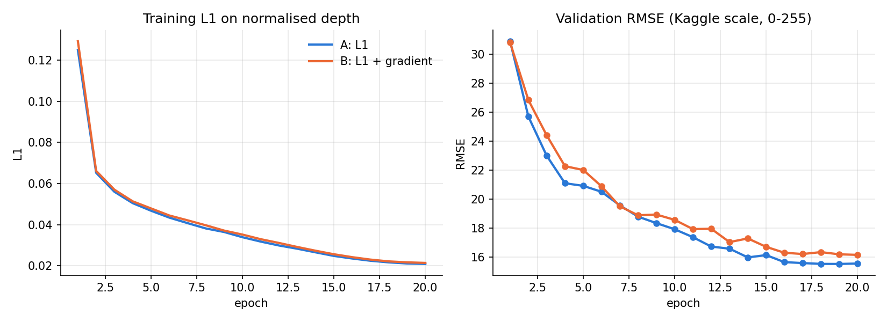
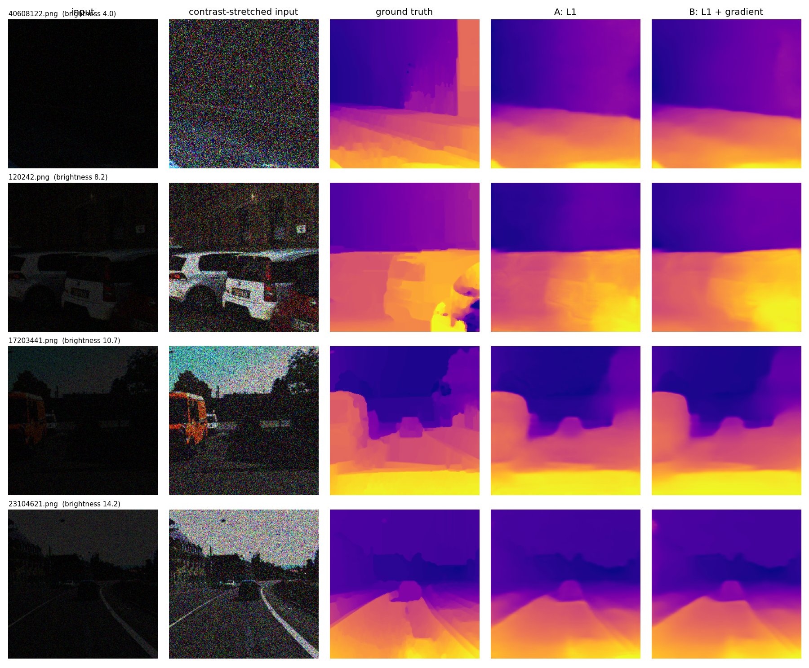
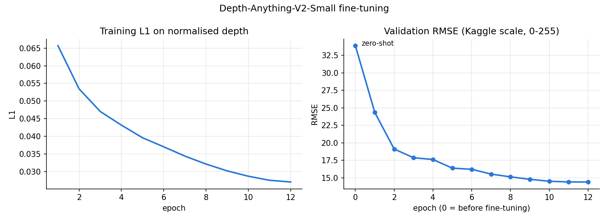
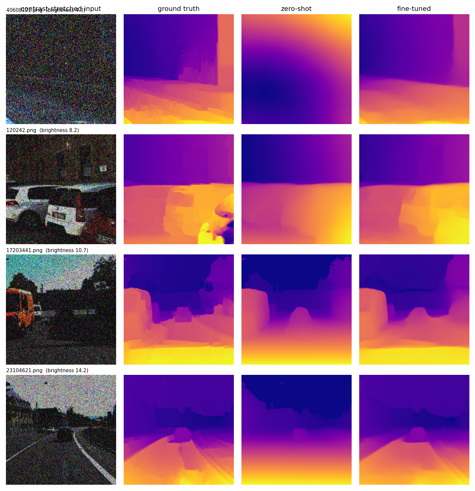

# Robust monocular depth estimation under low light and noise

Predicting depth maps from single RGB images that are both very dark and noisy. A U-Net baseline (two losses compared) and a fine-tuned Depth-Anything-V2-Small model, trained on 6,686 image–depth pairs from a Kaggle competition in the Deep Learning Practice course (IIT Madras BS).

## Results

RMSE on a 0–255 scale, lower is better. Validation "unseen" excludes 240 validation images whose scene also appears in training (see below).

| Model | Validation (unseen 596) | Kaggle private | Kaggle public |
|---|---|---|---|
| U-Net, ResNet-34 encoder, L1 loss | 16.72 | 16.58 | 15.67 |
| Depth-Anything-V2-Small, fine-tuned | **15.60** | **16.14** | **14.48** |

Both submissions use horizontal-flip test-time augmentation.

## Data

- 6,686 training and 836 validation image–depth pairs, 836 test images; 256×256.
- Every image is low-light and noisy (mean brightness about 9 out of 255). The data isn't redistributed here.
- **Repeated scenes:** the 6,686 training depth maps contain only 5,868 unique ones, and 240 of the 836 validation images have a depth map identical to a training image (same scene, different noise). Those 240 score optimistically, so validation is also reported on the 596 unseen images, which is a closer guide to the private leaderboard than the full validation set.

## How the score works

The course's submission script resizes each predicted map to 128×128 and min-max rescales it to 0–255 **per image** before RMSE. Only the relative depth layout inside an image counts, not its scale or offset. So:
- targets are per-image min-max normalised depth;
- validation repeats the submission script's steps exactly, so validation and leaderboard are on the same scale.

## Approach

- **Pre-processing:** each image is divided by its own 99th-percentile value (contrast stretch for low light), then ImageNet normalisation. Horizontal flips as augmentation.
- **Notebook 1, U-Net comparison** ([`01_unet_loss_comparison.ipynb`](notebooks/01_unet_loss_comparison.ipynb)): `segmentation_models_pytorch` U-Net with an ImageNet-pretrained ResNet-34 encoder, 20 epochs, AdamW, one-cycle schedule, mixed precision. Two losses, everything else identical:
  - A: L1 → validation RMSE 15.53
  - B: L1 + gradient loss (edge matching) → 16.15
  - L1 alone won (one run each).
- **Notebook 2, Depth-Anything-V2-Small** ([`02_depth_anything_finetune.ipynb`](notebooks/02_depth_anything_finetune.ipynb)): 25M parameters, DINOv2 ViT-S encoder and DPT decoder, input resized to 350 px. Its output is relative inverse depth on an arbitrary scale, so predictions are min-max normalised per image before the L1 loss, which makes the loss ignore scale like the metric does. Encoder learning rate 1e-5, decoder 1e-4, 12 epochs.

## Findings

- **Fine-tuning is essential:** the pretrained model scores 33.9 on validation zero-shot; fine-tuned, 14.4.
- **The pretrained model helps most on the darkest images.** Validation RMSE by brightness third (all 836 images):

  | Brightness third | U-Net | Depth Anything |
  |---|---|---|
  | Darkest (3.4–8.1) | 19.18 | 17.98 |
  | Middle (8.1–10.9) | 15.58 | 14.09 |
  | Brightest (10.9–21.9) | 9.83 | 10.05 |

- **Error falls steeply with brightness for both models.** On the darkest images the input is close to pure noise and only the rough layout is recovered.
- **Flip test-time augmentation:** a small gain for the U-Net (15.53 → 15.35), negligible for Depth Anything.
- **Cost on a T4 GPU:** U-Net 55 s per epoch, Depth Anything 143 s per epoch.

### U-Net: training curves and sample predictions

### Depth Anything: training curves and sample predictions

## Limitations and next steps

- One run per configuration, one seed: the A vs B gap (about 0.6) is consistent across epochs but not tested for significance.
- Validation was still improving slightly when the learning-rate schedules ended; longer training may help.
- Not tried: denoising or low-light enhancement before depth estimation, a larger Depth Anything model, training on train + validation, ensembling the two models.

## Run

Kaggle notebooks, GPU T4, Internet on (pretrained weights download), competition data attached. Each notebook writes `submission.csv` and its figures to `images/`.

## Credits

Data and the submission script come from the course competition. Depth Anything V2: Yang et al., 2024 (`depth-anything/Depth-Anything-V2-Small-hf` on Hugging Face). U-Net from `segmentation_models_pytorch`.
